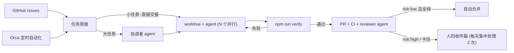

# 并行 Agent 系统搭建交接文档

> 用途：在一个新的个人 demo 项目里搭建“多个 coding agent 并行开发”的系统，并逐步把并行数量从几个扩展到几十个。
> 读者：接手执行的人或 agent（Claude Code / Kiro 等）。
> 日期：2026-10-30

---

## 0. 给接手者的执行说明

1. 按第 4 节的阶段顺序执行。每个阶段都有**验收标准**，达标后再进下一阶段。
2. 遇到标了 **【需用户确认】** 的地方，先停下来问用户，不要自己决定。
3. 第 3 节是需要原样放进目标仓库的文件模板。可以按实际技术栈调整，但每个文件要解决的问题不能丢。
4. 涉及 Orca CLI 的命令，先运行 `orca skills get orca-cli` 和 `orca skills get orchestration`，加载和本机版本匹配的用法说明。本文写的是 Orca 1.4.244 的用法，新版本以 CLI 输出为准。

---

## 1. 核心思路（为什么这样搭）

一个人同时**盯得住**的 agent 大约只有 5 个，这个上限改变不了。能并行的任务数取决于：**每个 agent 平均需要人多少注意力**。

```
可并行任务数 ≈ 你能投入的注意力 ÷ 每个任务平均占用的注意力
```

所以整个系统都在做一件事：降低每个任务对人的占用。

| 手段 | 落地方式 |
|---|---|
| 意图写在开工前 | 统一的任务简报模板（目标 / 改动 / 约束 / 可改范围 / 验收命令） |
| 自动验证代替人看过程 | 一条命令 `npm run verify` 跑完类型检查、lint、单测、E2E |
| 免掉权限弹窗 | Claude Code 权限白名单，常用命令不再逐条确认 |
| 并行互不干扰 | 每个任务一个 git worktree，端口和数据库按 worktree 隔离，代码按功能分目录 |
| 人只看例外 | CI + reviewer agent 把关，低风险 PR 自动合并，卡住的任务亮未读标记 |
| 分层管理 | 大功能交给协调者 agent 拆成任务 DAG，人只和协调者对话 |
| 不需要人启动 | Orca 定时自动化：分诊 issue、自动派发、补测试、升级依赖 |

整体流程：



---

## 2. 前置条件

### 2.1 已知的本机环境（2026-10-30 检查结果）

| 项 | 状态 | 处理 |
|---|---|---|
| 操作系统 | Windows，shell 为 Git Bash | 脚本统一用 Node 写，避免 bash/PowerShell 差异 |
| Orca | 1.4.244，已安装 | CLI 不在 PATH 里，见 2.2 |
| Claude Code | 2.1.223 | 可用 |
| Codex | 未安装 | 可选，用于交叉审查 |
| Node | v24.13.0 | 可用 |
| git | 2.42.0 | 可用 |
| gh | 2.102.0 | `gh auth status` 读 keyring 超时，需要重新登录 |

### 2.2 环境准备（由用户执行）

```bash
# 1) 把 Orca CLI 加入 PATH（Windows 用户环境变量），然后重开终端
#    目录：C:\Users\lulinhu\AppData\Local\Programs\orca\resources\bin
orca --version            # 应输出 1.4.x

# 2) 重新登录 GitHub CLI
gh auth login
gh auth status

# 3) Windows 下 worktree 路径容易超长
git config --global core.longpaths true

# 4) 可选：安装 Codex 做交叉审查
npm i -g @openai/codex
```

### 2.3 【需用户确认】开工前的决策

| 决策 | 默认建议 | 说明 |
|---|---|---|
| 项目位置 | `F:\project\AINative\agent-fleet-demo`，独立 git 仓库 | 不要和现有项目混在一起 |
| demo 做什么 | “个人阅读清单”应用 | 功能点容易拆成互相独立的小任务 |
| 技术栈 | TypeScript + React/Vite + Hono + SQLite（better-sqlite3）+ Vitest + Playwright | 可替换，但必须保留一条命令跑完验证 |
| agent | Claude Code；可选加 Codex 做 reviewer | 不同模型互审能发现更多问题 |
| GitHub 远程仓库 | 建议建 public 仓库 | 私有仓库在免费账户下不能设分支保护，自动合并要退回 3.8 的备选方案 |
| 同时运行的 agent 上限 | 起步 3，稳定后 5，再往上加 | 机器内存和 API 额度也是上限 |

---

## 3. 目标仓库的文件清单与模板

```
agent-fleet-demo/
├─ AGENTS.md                      # agent 的工作规则（最重要）
├─ CLAUDE.md                      # 只有一行：@AGENTS.md
├─ orca.yaml                      # worktree 创建时自动执行的 setup
├─ .claude/settings.json          # Claude Code 权限白名单
├─ .gitattributes                 # 统一 LF，避免 Windows 换行冲突
├─ .github/
│  ├─ workflows/ci.yml
│  └─ pull_request_template.md
├─ docs/agent/
│  ├─ brief-template.md           # 任务简报模板
│  ├─ reviewer-prompt.md          # reviewer agent 提示词
│  └─ coordinator-prompt.md       # 协调者 agent 提示词
├─ scripts/worktree-setup.mjs     # 给每个 worktree 分配端口和数据库
├─ playwright.config.ts
└─ src/
   ├─ server/app.ts               # 自动加载 features/*/routes.ts
   ├─ server/db.ts                # 自动执行 features/*/migrations/*.sql
   ├─ web/main.tsx                # 用 import.meta.glob 自动注册 features/*/page.tsx
   └─ features/
      └─ items/                   # 一个功能一个目录，互不干扰
         ├─ routes.ts
         ├─ migrations/20261030T1200_items.sql
         ├─ page.tsx
         ├─ items.test.ts         # Vitest 单测
         └─ items.e2e.ts          # Playwright E2E
```

**为什么要自动发现路由、页面和迁移：** 如果每加一个功能都要改一个公共的路由表或 schema 文件，5 个并行任务会在同一个文件上冲突。按目录自动发现之后，每个任务只需要新建自己的目录。迁移文件用时间戳命名，彼此不会撞名。

### 3.1 `AGENTS.md`

```markdown
# Agent 工作规则

## 项目
个人阅读清单应用。后端 Hono + SQLite，前端 React + Vite。

## 命令
- 安装：npm ci（worktree 创建时 Orca 已自动执行）
- 开发：npm run dev（端口读 .env.local，每个 worktree 不同）
- 验证：npm run verify   ← 声称完成前必须通过

## 目录与归属
- 每个功能只在 src/features/<功能名>/ 下工作。
- 路由、页面、迁移都会被自动发现，不要修改 src/server/app.ts、src/server/db.ts、src/web/main.tsx。
- 需要改简报“可改范围”之外的文件时，停下来提问，不要自己扩大范围。

## 完成的定义
1. npm run verify 全部通过。
2. 新功能至少有 1 个单测和 1 个 E2E。
3. 已开 PR，描述按模板填写，并打好风险标签。
4. 已更新 Orca 卡片状态（见下）。

## Orca 状态汇报
- 关键节点更新卡片说明：orca worktree set --worktree active --comment "<一句话进度>" --json
- 开 PR 后：orca worktree set --worktree active --workspace-status in-review --json
- 卡住需要人：先写清问题和你倾向的方案，然后
  orca worktree set --worktree active --comment "BLOCKED: <问题>" --unread --json
  然后停止，不要猜。

## 风险分级（决定是否自动合并）
- risk:low：只改了自己 feature 目录，没有新依赖，没有修改已有迁移。
- risk:high：其他所有情况，包括改 package.json、公共代码、CI、orca.yaml。

## 禁止
- 不要 force push，不要改写已推送的历史。
- 不要跳过或删除测试来让 verify 通过。
- 不要修改 .github/、orca.yaml、scripts/worktree-setup.mjs、.claude/，除非简报明确要求。
- 不要读取或提交 .env、.env.local。

## Git / PR
- 分支由 Orca 创建，直接在当前分支提交。
- 提交信息：<功能名>: <做了什么>
- 开 PR：gh pr create --fill --label risk:low|risk:high，并按模板补全描述。
```

### 3.2 `CLAUDE.md`

```markdown
@AGENTS.md
```

### 3.3 `orca.yaml`

worktree 创建后自动安装依赖并分配端口。

```yaml
scripts:
  setup: |
    npm ci
    node scripts/worktree-setup.mjs
```

> 字段格式以当前 Orca 版本为准。如果不生效，可在 Orca 的 Settings → Repository → Worktree Hooks 里配置同样的命令。验证方法：新建 worktree 后，确认目录下生成了 `.env.local`。

### 3.4 `scripts/worktree-setup.mjs`

```js
// 每个 worktree 分配独立端口和数据库文件，避免并行 dev server / E2E 冲突
import { createHash } from 'node:crypto';
import { createServer } from 'node:net';
import { mkdirSync, writeFileSync } from 'node:fs';
import { resolve } from 'node:path';

const root = process.cwd();
const hash = parseInt(createHash('sha1').update(root).digest('hex').slice(0, 6), 16);
let apiPort = 4000 + (hash % 500) * 2; // 4000-4998，成对分配

const isFree = (port) =>
  new Promise((done) => {
    const s = createServer()
      .once('error', () => done(false))
      .once('listening', () => s.close(() => done(true)));
    s.listen(port, '127.0.0.1');
  });

while (!((await isFree(apiPort)) && (await isFree(apiPort + 1)))) apiPort += 2;

mkdirSync(resolve(root, '.data'), { recursive: true });
const dbFile = resolve(root, '.data', 'dev.sqlite').replace(/\\/g, '/');

writeFileSync(
  resolve(root, '.env.local'),
  `API_PORT=${apiPort}\nWEB_PORT=${apiPort + 1}\nDATABASE_FILE=${dbFile}\n`,
);
console.log(`worktree ports: api=${apiPort} web=${apiPort + 1}`);
```

`.gitignore` 里加上 `.env.local` 和 `.data/`。后端、Vite、Playwright 都从 `.env.local` 读端口，没有这个文件时（如 CI）用默认值。

### 3.5 `package.json` 中的脚本

```json
{
  "scripts": {
    "dev": "concurrently -k \"npm:dev:api\" \"npm:dev:web\"",
    "typecheck": "tsc --noEmit",
    "lint": "eslint .",
    "test": "vitest run",
    "e2e": "playwright test",
    "verify": "npm run typecheck && npm run lint && npm run test && npm run e2e"
  }
}
```

`verify` 要尽量快（目标 2 分钟内）。agent 每次改完都会跑，慢了会拖累所有任务。

### 3.6 `playwright.config.ts`

```ts
import { defineConfig } from '@playwright/test';
import dotenv from 'dotenv';

dotenv.config({ path: '.env.local' });
const webPort = Number(process.env.WEB_PORT ?? 5173);

export default defineConfig({
  testDir: 'src',
  testMatch: '**/*.e2e.ts',
  use: { baseURL: `http://127.0.0.1:${webPort}` },
  webServer: {
    command: 'npm run dev',
    url: `http://127.0.0.1:${webPort}`,
    reuseExistingServer: !process.env.CI,
    timeout: 60_000,
  },
});
```

E2E 文件用 `.e2e.ts` 后缀，Vitest 默认不会匹配到它们，两套测试互不干扰。

### 3.7 `.claude/settings.json`（权限白名单）

并行时最大的注意力消耗之一是 agent 不停弹权限确认。把日常命令放进白名单：

```json
{
  "permissions": {
    "allow": [
      "Edit",
      "Write",
      "Bash(npm run *)",
      "Bash(npm ci)",
      "Bash(npx playwright *)",
      "Bash(git status*)",
      "Bash(git diff*)",
      "Bash(git add *)",
      "Bash(git commit *)",
      "Bash(git push)",
      "Bash(git push -u *)",
      "Bash(gh pr *)",
      "Bash(gh issue view *)",
      "Bash(gh issue list *)",
      "Bash(orca *)"
    ],
    "deny": [
      "Bash(git push --force*)",
      "Bash(git push -f*)",
      "Bash(git reset --hard*)",
      "Bash(rm -rf *)",
      "Read(.env)",
      "Read(.env.local)"
    ]
  }
}
```

> 规则写法以当前 Claude Code 版本为准，可以在 Claude Code 里用 `/permissions` 查看是否生效。不要用 `--dangerously-skip-permissions`，除非运行在隔离的沙箱里。

### 3.8 `.github/workflows/ci.yml`

```yaml
name: ci
on:
  pull_request:
  push:
    branches: [main]
jobs:
  verify:
    runs-on: ubuntu-latest
    steps:
      - uses: actions/checkout@v4
      - uses: actions/setup-node@v4
        with:
          node-version: 24
          cache: npm
      - run: npm ci
      - run: npx playwright install --with-deps chromium
      - run: npm run verify
```

**自动合并的两种做法：**

- 首选（public 仓库）：开启仓库的 Allow auto-merge，给 `main` 设分支保护并把 `verify` 设为必需检查。reviewer agent 认可后执行 `gh pr merge <n> --auto --squash`，CI 绿了 GitHub 自动合并。
- 备选（私有仓库，没有分支保护）：reviewer agent 执行 `gh pr checks <n> --watch`，全部通过后再执行 `gh pr merge <n> --squash`。

**注意：** 所有 agent 都用你的 GitHub 账号，GitHub 不允许批准自己的 PR。所以 reviewer 用评论加标签（`agent-approved` / `changes-requested`）表达结论，不用 `--approve`。

### 3.9 `.github/pull_request_template.md`

```markdown
## 做了什么
<!-- 1-3 句 -->

## 怎么验证的
- [ ] npm run verify 通过
- 新增测试：

## 风险
risk:low / risk:high，理由：

## 人工介入次数
<!-- 本任务过程中 agent 向人提问或被人纠正的次数，用于统计 -->
0
```

### 3.10 `docs/agent/brief-template.md`（任务简报）

和 Orca 任务规格的要求一致。每个任务都按这个格式写，写不清楚就说明任务还没想好，不该派出去。

```markdown
# <任务名>

## 目标
<用户能看到的结果，1-2 句>

## 改动
<要实现的具体内容>

## 约束
<不能破坏的行为、兼容性要求>

## 可改范围
- 允许：src/features/<功能名>/**
- 禁止：其他所有文件。需要改时停下来提问。

## 验收
- npm run verify 通过
- <具体的可观察结果，如：E2E 覆盖“添加标签后列表可按标签筛选”>

## 完成后
按 AGENTS.md 开 PR、打风险标签、更新 Orca 卡片状态。
```

### 3.11 `docs/agent/reviewer-prompt.md`

```markdown
你是代码审查者，审查 PR #{{PR}}。

1. gh pr checkout {{PR}}，阅读 gh pr view {{PR}} 和 gh pr diff {{PR}}。
2. 对照 PR 关联的 issue 和 AGENTS.md 检查：
   - 是否只改了可改范围内的文件
   - 是否实现了简报的验收标准
   - 测试是否真的覆盖了新行为，有没有删除或跳过已有测试
   - 风险标签是否正确
3. 本地运行 npm run verify。
4. 给出结论：
   - 通过：gh pr comment {{PR}} --body "<审查结论>"，加标签 agent-approved。
     如果是 risk:low，执行自动合并（见 AGENTS.md / CI 说明）。
   - 不通过：gh pr comment 写明具体问题和修改建议，加标签 changes-requested。
   - risk:high：只写审查意见，不合并，执行
     orca worktree set --worktree active --comment "PR #{{PR}} 需要人工审查" --unread --json
不要修改代码。
```

### 3.12 `docs/agent/coordinator-prompt.md`

```markdown
你是协调者，负责把一个大功能拆开并行完成。目标：{{大功能描述}}

1. 先运行 orca skills get orchestration 加载用法说明；需要每个任务独立 worktree 时，
   再加载 references/placement-and-remote.md。阅读 AGENTS.md。
2. 把目标拆成不超过 6 个任务，每个任务按 docs/agent/brief-template.md 写简报。
   各任务的“可改范围”不能重叠；依赖只在真正需要先后顺序时才加，链条不超过 3 层。
3. 把拆分计划发给我确认。这是整个过程中唯一需要我主动参与的一步。
4. 确认后用 orca orchestration run-create / task-create / worker-start 分发，
   没有依赖的任务在同一波一起启动。
5. 用 orchestration check --wait 循环处理 worker_done、question、escalation。
   在简报范围内能回答的问题自己回答；超出范围的才转给我。
6. 全部结束后，按任务汇报：结果、证据（PR 链接、verify 结果）、遗留问题。
```

---

## 4. 分阶段实施

### 阶段 1：单个 agent 闭环

**做什么**
1. 按 2.3 的决策创建仓库，写好第 3 节的所有文件。
2. 实现最小功能 `items`（添加、列出阅读条目），包含单测和 E2E，`npm run verify` 通过。
3. 推送到 GitHub，确认 CI 跑绿。
4. 注册到 Orca：`orca repo add --path <仓库绝对路径> --json`，记下返回的 repo id。
5. 写一个小任务的简报（比如“条目支持标记已读”），用交接方式派出去：

```bash
orca worktree create --repo path:<仓库绝对路径> --name feat-read-status --no-parent \
  --agent claude --prompt "$(cat briefs/read-status.md)" --json
```

6. **派出去之后不要插手**，只记录 agent 来找你的次数和原因。

**验收标准**
- 新 worktree 自动生成了 `.env.local`（说明 setup 生效）。
- agent 不需要人介入就完成任务并开了 PR，CI 通过。
- 如果做不到，把每次被打断的原因补进 AGENTS.md、简报模板或权限白名单，然后重跑，直到做到。

### 阶段 2：3 到 5 个任务并行

**做什么**
1. 在 GitHub 建 5 个 issue，每个 issue 正文就是一份简报。阅读清单的建议功能：
   - 标签（tags）
   - 搜索（search）
   - 导入/导出 JSON（import-export）
   - 阅读统计页（stats）
   - 稍后提醒（reminders）
2. 先派 3 个，稳定后再加到 5 个。`--issue` 把 worktree 和 issue 关联起来：

```bash
orca worktree create --repo path:<仓库> --name feat-tags --no-parent --issue 2 \
  --agent claude --prompt "$(gh issue view 2 --json body --jq .body)" --json
```

3. 用 `orca worktree ps --json` 或 Orca 界面查看整体状态。只处理亮了未读标记的 worktree。

**验收标准**
- 3 个以上 agent 同时运行 dev server 和 E2E，没有端口或数据库冲突。
- PR 之间没有合并冲突，或者冲突只出现在 `package-lock.json` 这类预期之内的文件。
- 超过一半的任务无人介入完成。

**常见问题**
- 两个任务都改了 `package.json`：在简报里规定“新依赖需提问”，或者先由一个任务统一装好依赖。
- 端口冲突：确认后端、Vite、Playwright 都读取了 `.env.local`。
- 磁盘占用大：每个 worktree 都有一份 `node_modules`。可以改用 pnpm（共享存储），并同步修改 `orca.yaml`。

### 阶段 3：自动关卡

**做什么**
1. 按 3.8 配置自动合并（首选或备选方案）。
2. 在仓库建标签：`risk:low`、`risk:high`、`agent-approved`、`changes-requested`、`ready`、`idea`。
3. 每个 PR 开出后，派一个 reviewer agent：

```bash
orca worktree create --repo path:<仓库> --name review-pr-12 --no-parent --pr 12 \
  --agent claude --prompt "$(sed 's/{{PR}}/12/g' docs/agent/reviewer-prompt.md)" --json
```

装了 Codex 的话，reviewer 用 `--agent codex`，和写代码的模型不同效果更好。

**验收标准**
- risk:low 的 PR 从开出到合并全程无人操作。
- 你只需要处理 risk:high 和标了未读的任务，每天集中看 2 次就够。

### 阶段 4：协调者模式

**做什么**
1. 选一个跨越多个模块的大功能，比如“多用户与分享”。
2. 在 Orca 里主仓库的终端启动一个 Claude Code，把 `docs/agent/coordinator-prompt.md` 填好目标后发给它。
3. 你只确认一次拆分计划，之后只回答协调者转过来的问题。

**验收标准**
- 协调者把任务分波并行派出，所有任务都有明确结果（成功/失败及证据）。
- 你和 worker 之间没有直接对话。

### 阶段 5：定时自动化

这一层让任务不需要人启动，并行数量从这里开始可以往上走。先用 `--disabled` 创建，`orca automations run <id>` 手动跑通后再启用。

| 自动化 | 频率 | 作用 |
|---|---|---|
| issue 分诊 | 工作日 09:00 | 把 `idea` 标签的 issue 改写成简报格式，打 `ready` 标签；写不清楚的留评论问人 |
| 自动派发 | 每小时 | 查看正在运行的 worktree 数，未达上限时为 `ready` issue 创建 worktree 并启动 agent |
| PR 审查 | 每小时 | 为没有审查结论的 PR 派 reviewer agent |
| 补测试 | 每天夜里 | 找覆盖率最低的模块补测试，开 risk:low PR |
| 依赖升级 | 每周 | 只升 patch/minor 版本，verify 通过后开 PR |
| 收件箱摘要 | 每天 2 次 | 汇总需要人处理的 PR 和卡住的 worktree |

示例：

```bash
orca automations create --name "issue-triage" --trigger weekdays --time 09:00 \
  --provider claude --repo path:<仓库> --disabled \
  --prompt "阅读 AGENTS.md 和 docs/agent/brief-template.md。把所有带 idea 标签的 open issue 改写成简报格式（gh issue edit），改好的去掉 idea、加上 ready；信息不足的留评论说明缺什么。" --json

orca automations create --name "dispatcher" --trigger hourly \
  --provider claude --repo path:<仓库> --disabled \
  --precheck "gh issue list --label ready --state open --limit 1 --json number --jq length | grep -q 1" \
  --prompt "运行 orca worktree ps --json 统计正在运行的任务数。上限是 5。未满时，按编号从小到大取 ready 标签的 issue，对每个执行 orca worktree create --no-parent --issue <编号> --agent claude --prompt <issue 正文>，然后把 issue 的 ready 标签换成 in-progress。" --json
```

> `--precheck` 命令在哪个 shell 里执行，取决于 Orca 在 Windows 上的实现。启用前先确认 precheck 能正确跳过和放行。

**验收标准**
- 往 GitHub 里写一个 `idea` issue，不做其他操作，第二天能看到对应的 PR。

---

## 5. 衡量指标

每周统计一次（数据来自 PR 描述里的“人工介入次数”和 `gh pr list`）：

| 指标 | 含义 | 目标方向 |
|---|---|---|
| 无人介入完成率 | 人工介入次数为 0 的 PR 占比 | 越高越好，这是最核心的指标 |
| verify 首次通过率 | agent 第一次声称完成时 verify 就通过的比例 | 越高越好 |
| 每个任务的人工耗时 | 你在每个任务上花的分钟数 | 越低越好 |
| 丢弃重跑率 | 方向错了直接丢掉重跑的任务占比 | 偏高说明简报写得不清楚 |

每次有人工介入，都问一句：**这次介入能不能写进 AGENTS.md、简报模板、权限白名单或测试里，让下次不再发生？** 系统就是这样一步步变得能并行更多任务的。

---

## 6. 风险与边界

- **代码质量：** 并行越多，合进去的代码越多。测试覆盖不够时，自动合并会积累问题。前期宁可多标 risk:high。
- **资源上限：** 每个 agent 都占内存、CPU 和模型额度。dispatcher 的并行上限要根据实际情况调整。
- **安全：** `.env` 不进仓库，不进 agent 上下文。agent 用的是你的 GitHub 账号，权限白名单不要放开 `git push --force` 和删除类命令。
- **版本差异：** 本文的 Orca 命令基于 1.4.244，`orca.yaml` 字段和 Claude Code 权限写法可能随版本变化，以实际工具的输出和文档为准。

## 参考

- Orca 官网：https://www.onorca.dev/
- Orca 源码与文档：https://github.com/stablyai/orca
- Orca 创始人访谈整理（400+ worktree，其中 200+ 用于定时自动流程）：https://yuzheng.substack.com/p/when-twenty-ai-agents-need-one-human
